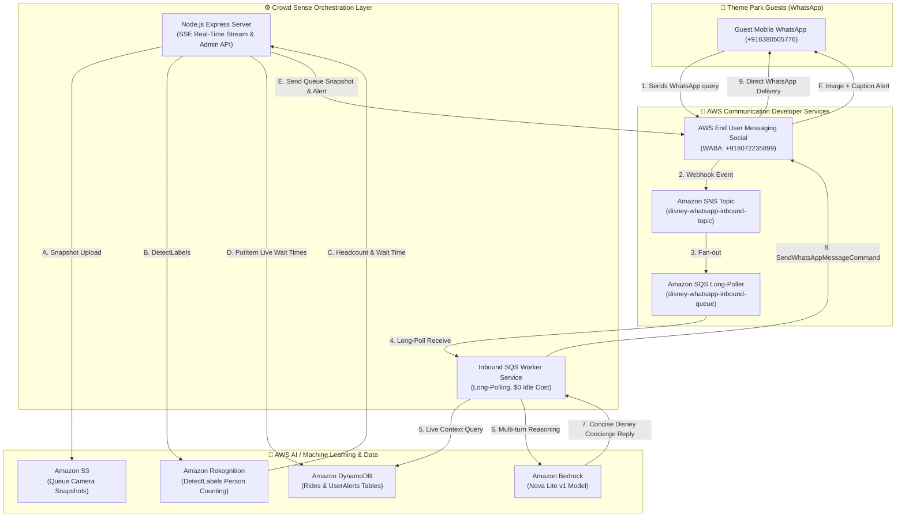

# 🏰 Disney Crowd Sense AI
### Real-Time Attraction Queue Analytics & Proactive WhatsApp Concierge
**Powered by AWS Communication Developer Services (AWS End User Messaging Social), Amazon Bedrock Nova Lite, Amazon Rekognition, Amazon DynamoDB, and Amazon S3.**

[](https://opensource.org/licenses/MIT)
[](https://aws.amazon.com/end-user-messaging/)
[](https://aws.amazon.com/bedrock/)
[](https://aws.amazon.com/rekognition/)
[](https://aws.amazon.com/dynamodb/)
[](https://aws.amazon.com/s3/)

---

## 💡 Overview & Problem Statement

Theme park guests spend up to **60% of their park day waiting in lines**, causing severe vacation fatigue and missed experiences. Traditional park mobile applications suffer from:
1. **High friction**: Require large app downloads, registration, account creation, and constant manual screen refreshing.
2. **Reactive, static information**: Merely display static posted times without proactive intelligence or camera-based ground-truth headcount.
3. **No automatic crowd diversion**: Guests crowd into peak queues unaware that an identical or complementary attraction nearby has a 10-minute walk-on line.

**Disney Crowd Sense AI** transforms park navigation by meeting guests **where they already communicate—on WhatsApp**. Combining **Amazon Rekognition** camera queue analysis, **Amazon DynamoDB** real-time metrics, **Amazon Bedrock Nova Lite** AI reasoning, and **AWS End User Messaging Social**, it delivers:
* 📸 **Camera-Based Queue Headcount Estimation**: Automated queue headcount analysis with Amazon Rekognition `DetectLabels` and automated S3 snapshot ingestion.
* 🤖 **Natural Language WhatsApp Concierge**: Instant AI conversational assistance on WhatsApp powered by Amazon Bedrock Nova Lite, answering questions like *"Can I go Indiana Jones Adventure now?"* or *"Show shortest lines"*.
* 🔀 **Proactive Crowd Diversion**: Intelligent crowd recommendations suggesting nearby low-wait rides when popular rides hit peak surge.
* 🔔 **Automated Wait-Drop Alerts & Vision Photo Updates**: Live WhatsApp alerts (with camera snapshots) pushed directly to visitors when lines clear up.

---

## 🏗️ Architecture Diagram



---

## 💬 AWS Communication Developer Services (CDS) Runtime Integration

This project deeply integrates **AWS End User Messaging Social** at runtime:

1. **Two-Way Conversational WhatsApp (Meta WABA)**:
   - Linked WABA ID: `waba-3bcb1c396ec446dc8944a2639a397264` (Meta ID: `1642740654108860`).
   - Bot WhatsApp Phone Number: **`+91 80722 35899`**
   - Verified Partner Recipient: **`+91 63805 05776`**
2. **Event-Driven Inbound Routing**:
   - Inbound WhatsApp messages are received by AWS Social Messaging and routed to an **Amazon SNS Topic** (`disney-whatsapp-inbound-topic`), which forwards to an **Amazon SQS Queue** (`disney-whatsapp-inbound-queue`).
   - The backend worker [`whatsappInboundWorker.js`](backend-node/services/whatsappInboundWorker.js) long-polls SQS with $0 idle cost.
3. **Outbound Messaging with Media Support**:
   - Uses `@aws-sdk/client-socialmessaging` `SendWhatsAppMessageCommand`.
   - Sends rich formatted text notifications and camera snapshot images stored in **Amazon S3** with pre-signed URLs.

---

## 📱 How to Interact & Test (For Judges & Evaluators)

### Option A: Test Live WhatsApp Right Now!
1. Open WhatsApp on your phone.
2. Send a message to the verified Disney AI Concierge: **`+91 80722 35899`**
3. Try asking:
   - *"Can I go Indiana Jones Adventure now?"*
   - *"Which rides have the shortest wait right now?"*
   - *"What is the wait time for Space Mountain?"*
   - *"Alert me when Space Mountain drops under 30 mins"*
4. Amazon Bedrock Nova Lite queries live Amazon DynamoDB metrics and responds instantly on WhatsApp!

### Option B: Run the Admin Operations Dashboard
1. Clone this repository:
   ```bash
   git clone https://github.com/YOUR_USERNAME/crowd-sense-ai.git
   cd crowd-sense-ai/backend-node
   ```
2. Install dependencies:
   ```bash
   npm install
   ```
3. Configure environment variables (copy `.env.example` to `.env`):
   ```bash
   cp .env.example .env
   ```
4. Start the backend:
   ```bash
   npm start
   ```
5. Open your browser at **[http://localhost:5000](http://localhost:5000)**.
6. Features available in the dashboard:
   - **Attraction Queue Controls**: Inspect live wait times for all 8 attractions synched with Amazon DynamoDB.
   - **Per-Attraction Camera Ingestion**: Click **"📷 Upload Feed"** on any ride (or select from the dropdown) to upload a camera photo. Amazon Rekognition detects queue count, uploads the frame to S3, updates DynamoDB, and dispatches the snapshot alert directly to real WhatsApp!
   - **⚡ "Send Live WhatsApp Ping"**: Click to send an instant connectivity ping to the verified phone number.
   - **Live Activity Stream**: Real-time monitor listening to inbound guest chats and outbound notifications via SSE.

---

## 🛠️ Tech Stack & AWS Services

* **AWS End User Messaging Social**: Meta WhatsApp Business Account (WABA) two-way messaging.
* **Amazon Bedrock**: High-speed conversational reasoning via `amazon.nova-lite-v1:0`.
* **Amazon Rekognition**: Computer vision `DetectLabels` queue headcount counting.
* **Amazon DynamoDB**: On-Demand NoSQL database for attraction state (`Rides`) and guest alerts (`UserAlerts`).
* **Amazon S3**: High-durability object storage for queue snapshots.
* **Amazon SQS & SNS**: Serverless event-driven message queuing and fan-out.
* **Node.js Express & Tailwind CSS**: Dashboard and real-time Server-Sent Events stream.

---

## 📄 License

This project is licensed under the **MIT License** — see the [LICENSE](LICENSE) file for details.
